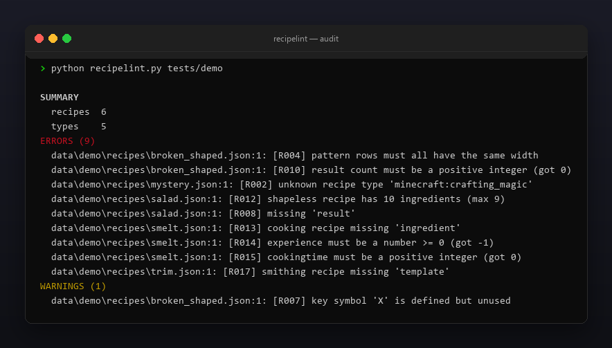
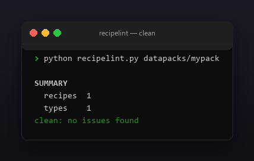

<p align="center"></p>

<p align="center">
  <a href="README.ru.md"></a>
  <a href="https://github.com/Celine1337/recipelint/releases"></a>
  <a href="https://github.com/Celine1337/recipelint/actions/workflows/ci.yml"></a>
  <a href="LICENSE"></a>
</p>


Validator for Minecraft datapack recipe JSON. A malformed recipe is silently
skipped by the game — it just never appears in the crafting book, with no error
in the log. recipelint reads your `data/<ns>/recipes/` (or `recipe/`) tree and
flags the problems before you load the pack:

- unknown or missing recipe `type`;
- shaped `pattern` rows of unequal width, symbols missing from `key`,
  unused key symbols;
- shapeless ingredient lists that are empty or over the 9-slot limit;
- cooking / stonecutting / smithing fields, result item ids and counts.

Single file, standard library only, Python 3.9+.


- Understands `crafting_shaped`, `crafting_shapeless`, the four cooking types,
  `stonecutting`, `smithing_transform` / `smithing_trim` and the
  `crafting_special_*` family.
- Accepts both old (`result: "item"`) and new (`result: {id, count}`) result
  forms, and `{item}` / `{tag}` / list ingredients.
- Validates namespaced ids (`namespace:path`, lowercase) everywhere.
- Scans one recipe file or a whole datapack tree.
- `--json` machine-readable report; exit code `1` on errors for CI gating;
  `--strict` also fails on warnings.
- Colored ANSI output, `--no-color` and `NO_COLOR`.


| Code | Severity | Meaning |
|------|----------|---------|
| R000 | error | unreadable file, invalid JSON, or not an object |
| R001 | error | missing `type` |
| R002 | error | unknown recipe `type` |
| R003 | error | shaped recipe missing `pattern` |
| R004 | error | pattern rows not 1-3 / unequal width / too long |
| R005 | error | pattern symbol not defined in `key` |
| R006 | error | missing `key` or bad key ingredient |
| R007 | warning | key symbol defined but unused |
| R008 | error | missing `result` |
| R009 | error | result missing a valid item id / wrong shape |
| R010 | error | result `count` not a positive integer |
| R011 | error | shapeless `ingredients` missing / empty / bad entry |
| R012 | error | shapeless recipe over 9 ingredients |
| R013 | error | cooking / stonecutting / smithing ingredient missing or bad |
| R014 | error | `experience` negative or not a number |
| R015 | error | `cookingtime` not a positive integer |
| R016 | error | stonecutting `count` missing or not positive |
| R017 | error | smithing missing `template` / `base` / `addition` |


```console
$ python recipelint.py datapacks/mypack/data/mypack/recipes/iron_pickaxe.json
$ python recipelint.py datapacks/mypack      # whole tree
$ python recipelint.py datapacks/mypack --json
```

```
SUMMARY
  recipes  6
  types    5
ERRORS (9)
  data/demo/recipes/broken_shaped.json:1: [R004] pattern rows must all have the same width
  data/demo/recipes/broken_shaped.json:1: [R010] result count must be a positive integer (got 0)
  data/demo/recipes/mystery.json:1: [R002] unknown recipe type 'minecraft:crafting_magic'
  data/demo/recipes/salad.json:1: [R012] shapeless recipe has 10 ingredients (max 9)
  data/demo/recipes/salad.json:1: [R008] missing 'result'
  data/demo/recipes/smelt.json:1: [R013] cooking recipe missing 'ingredient'
  data/demo/recipes/smelt.json:1: [R014] experience must be a number >= 0 (got -1)
  data/demo/recipes/smelt.json:1: [R015] cookingtime must be a positive integer (got 0)
  data/demo/recipes/trim.json:1: [R017] smithing recipe missing 'template'
WARNINGS (1)
  data/demo/recipes/broken_shaped.json:1: [R007] key symbol 'X' is defined but unused
```

Exit codes: `0` — clean (or warnings only), `1` — errors (or warnings with
`--strict`), `2` — bad path.

Limits, on purpose: it validates structure, not game semantics — it cannot know
whether an item id actually exists in your version, or whether a tag is loaded.







```console
$ python -m unittest discover -s tests -v
```

34 tests cover every recipe family, each check and the exit codes. The demo and
all images are regenerable:

```console
$ python tools/make_demo.py       # tests/demo with one of each issue
$ pip install pillow
$ python tools/make_shots.py      # docs/audit.png, docs/clean.png
$ python tools/make_style.py tools/style.json docs/style
```


[MIT](LICENSE) © Celine1337