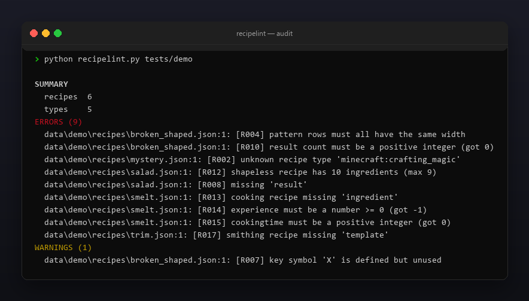
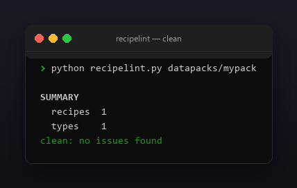

<p align="center"></p>

<p align="center">
  <a href="README.md"></a>
  <a href="https://github.com/Celine1337/recipelint/releases"></a>
  <a href="https://github.com/Celine1337/recipelint/actions/workflows/ci.yml"></a>
  <a href="LICENSE"></a>
</p>


Валидатор JSON-рецептов датапаков Minecraft. Сломанный рецепт игра молча
пропускает — он просто не появляется в книге крафта, без ошибки в логе.
recipelint читает дерево `data/<ns>/recipes/` (или `recipe/`) и находит проблемы
до загрузки пака:

- неизвестный или отсутствующий `type` рецепта;
- строки `pattern` разной ширины, символы без записи в `key`,
  неиспользуемые символы key;
- списки ингредиентов shapeless пустые или больше 9 слотов;
- поля cooking / stonecutting / smithing, id предметов и количества результата.

Один файл, только стандартная библиотека, Python 3.9+.


- Понимает `crafting_shaped`, `crafting_shapeless`, четыре типа cooking,
  `stonecutting`, `smithing_transform` / `smithing_trim` и семейство
  `crafting_special_*`.
- Принимает и старую (`result: "item"`), и новую (`result: {id, count}`) формы
  результата, и ингредиенты `{item}` / `{tag}` / списки.
- Везде валидирует namespaced-id (`namespace:path`, нижний регистр).
- Сканирует один файл рецепта или целое дерево датапака.
- `--json` — машинный отчёт; код `1` при ошибках для CI-гейта; `--strict`
  валит и на предупреждениях.
- Цветной ANSI-вывод, `--no-color` и `NO_COLOR`.


| Код | Уровень | Смысл |
|-----|---------|-------|
| R000 | ошибка | нечитаемый файл, неверный JSON или не объект |
| R001 | ошибка | нет `type` |
| R002 | ошибка | неизвестный `type` рецепта |
| R003 | ошибка | у shaped нет `pattern` |
| R004 | ошибка | строки pattern не 1-3 / разной ширины / слишком длинные |
| R005 | ошибка | символ pattern не определён в `key` |
| R006 | ошибка | нет `key` или плохой ингредиент key |
| R007 | предупр. | символ key определён, но не используется |
| R008 | ошибка | нет `result` |
| R009 | ошибка | у result нет валидного id предмета / неверная форма |
| R010 | ошибка | `count` результата не положительное целое |
| R011 | ошибка | `ingredients` shapeless нет / пуст / плохая запись |
| R012 | ошибка | у shapeless больше 9 ингредиентов |
| R013 | ошибка | ингредиент cooking / stonecutting / smithing отсутствует или плох |
| R014 | ошибка | `experience` отрицательный или не число |
| R015 | ошибка | `cookingtime` не положительное целое |
| R016 | ошибка | у stonecutting нет `count` или он не положительный |
| R017 | ошибка | у smithing нет `template` / `base` / `addition` |


```console
$ python recipelint.py datapacks/mypack/data/mypack/recipes/iron_pickaxe.json
$ python recipelint.py datapacks/mypack      # всё дерево
$ python recipelint.py datapacks/mypack --json
```

```
SUMMARY
  recipes  6
  types    5
ERRORS (9)
  data/demo/recipes/broken_shaped.json:1: [R004] pattern rows must all have the same width
  data/demo/recipes/broken_shaped.json:1: [R010] result count must be a positive integer (got 0)
  data/demo/recipes/mystery.json:1: [R002] unknown recipe type 'minecraft:crafting_magic'
  data/demo/recipes/salad.json:1: [R012] shapeless recipe has 10 ingredients (max 9)
  data/demo/recipes/salad.json:1: [R008] missing 'result'
  data/demo/recipes/smelt.json:1: [R013] cooking recipe missing 'ingredient'
  data/demo/recipes/smelt.json:1: [R014] experience must be a number >= 0 (got -1)
  data/demo/recipes/smelt.json:1: [R015] cookingtime must be a positive integer (got 0)
  data/demo/recipes/trim.json:1: [R017] smithing recipe missing 'template'
WARNINGS (1)
  data/demo/recipes/broken_shaped.json:1: [R007] key symbol 'X' is defined but unused
```

Коды возврата: `0` — чисто (или только предупреждения), `1` — ошибки (или
предупреждения с `--strict`), `2` — неверный путь.

Ограничения сознательные: он валидирует структуру, а не игровую семантику — не
может знать, существует ли id предмета в вашей версии и загружен ли тег.







```console
$ python -m unittest discover -s tests -v
```

34 теста покрывают все семейства рецептов, каждую проверку и коды возврата.
Демо и все картинки перегенерируются:

```console
$ python tools/make_demo.py       # tests/demo с по одной каждой проблеме
$ pip install pillow
$ python tools/make_shots.py      # docs/audit.png, docs/clean.png
$ python tools/make_style.py tools/style.json docs/style
```


[MIT](LICENSE) © Celine1337